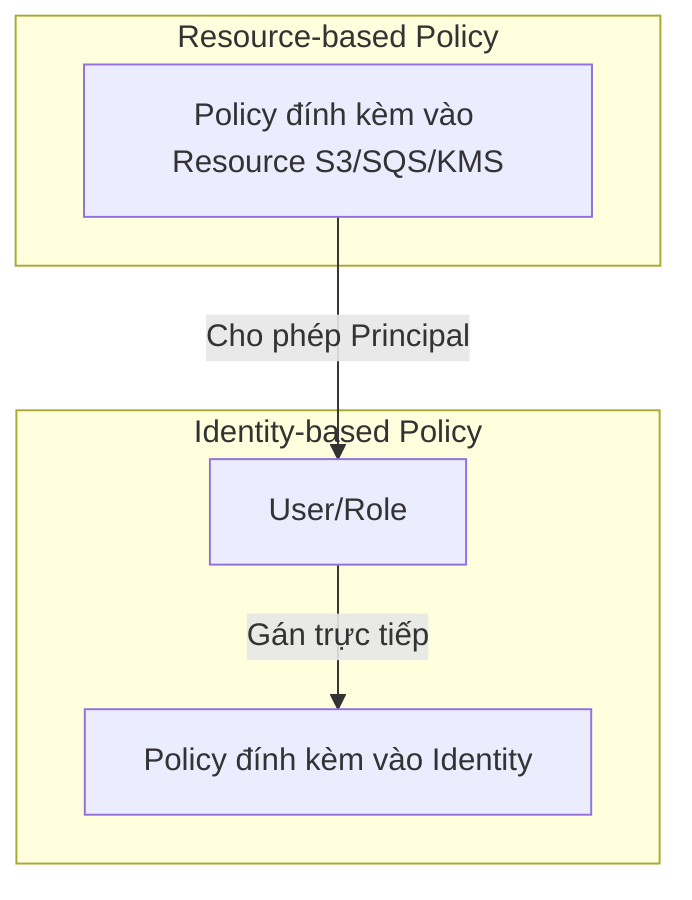
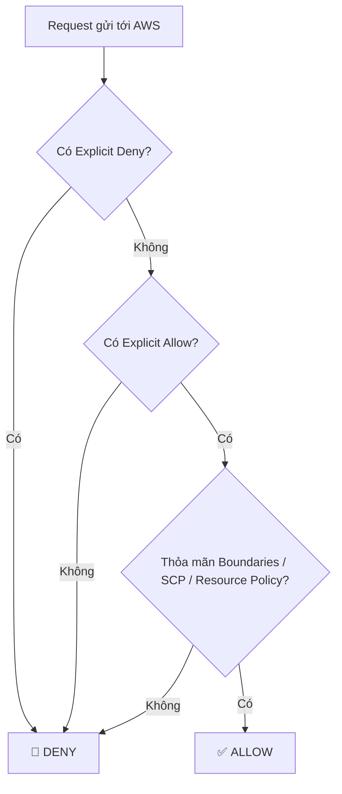

# 🔐 IAM (Identity and Access Management) — AWS DVA-C02 Notes

> **Domain:** Security (26%)  
> **Trọng tâm thi DVA-C02:** Roles & STS (AssumeRole), Policy Evaluation Logic, Permission Boundary, Resource-based vs Identity-based Policy.

---

## 💡 1. Khái niệm cốt lõi (Core Concepts)

| Khái niệm | Ý nghĩa | Khi nào sử dụng? |
| :--- | :--- | :--- |
| **IAM User** | Đối tượng đại diện cho 1 người dùng hoặc 1 ứng dụng lâu dài. Có Long-term Credentials (Password / Access Key ID + Secret Access Key). | Dùng cho con người truy cập Console/CLI, hoặc legacy system (hạn chế dùng Access Key cho app). |
| **IAM Group** | Tập hợp các IAM Users. Không chứa credentials, không dùng làm Principal trong policy. | Gán quyền chung cho một đội ngũ (ví dụ: Developers, Admins). |
| **IAM Role** | Đối tượng không có long-term credentials. Được gán (assume) tạm thời bởi User, AWS Services (Lambda, EC2), hoặc Federated Identity. | **Best Practice cho App/AWS Services**: Cho Lambda/EC2 gọi service khác, Cross-account access, Cognito/SAML authentication. |
| **IAM Policy** | Document định dạng JSON định nghĩa quyền hạn (Allow/Deny) cho các actions trên resources. | Đính kèm vào User, Group, Role hoặc Resource. |

---

## 📜 2. Các loại Policy & Phân biệt

### 2.1 Identity-based Policy vs Resource-based Policy

* **Identity-based Policy:**
  * Đính kèm vào IAM User, Group, hoặc Role.
  * Định nghĩa *Identity đó có thể làm gì*.
  * Gồm 2 loại:
    * **Managed Policy:** AWS Managed (do AWS tạo & quản lý, ví dụ `AdministratorAccess`) hoặc Customer Managed (do bạn tự định nghĩa, tái sử dụng được).
    * **Inline Policy:** Policy gán 1-1 trực tiếp cho 1 Identity, xóa Identity là mất policy (dùng khi không muốn chia sẻ policy cho ai khác).

* **Resource-based Policy:**
  * Đính kèm trực tiếp vào **Resource** (S3 Bucket Policy, SQS Queue Policy, SNS Topic Policy, Lambda Resource Policy, KMS Key Policy).
  * Định nghĩa *Ai (Principal) được phép làm gì với Resource này*.
  * **Đặc điểm quan trọng trong thi:** Giúp phân quyền **Cross-Account** mà không cần qua AssumeRole (nếu dùng Resource-based Policy + cho phép Principal từ Account khác).

---

## 🔑 3. STS (Security Token Service) & IAM Role

AWS STS phát hành **Temporary Security Credentials** (gồm Access Key ID, Secret Access Key, và **Session Token**).

### Các API chính của STS cần nhớ cho thi:
1. `AssumeRole`: Trả về temp credentials để đóng vai (assume) 1 IAM Role.
2. `AssumeRoleWithWebIdentity`: Dùng cho Federated Identity (Cognito, OIDC like Google, Facebook).
3. `GetCallerIdentity`: Trả về thông tin IAM identity hiện tại đang gọi API (rất hay dùng để debug permission trong CLI/SDK).
4. `GetSessionToken`: Lấy temp credentials cho IAM User (thường kết hợp với MFA).

> [!TIP]
> **Trust Policy (Trust Relationship):**
> Mỗi IAM Role đều phải có 1 **Trust Policy** (Resource-based policy của Role) định nghĩa **Ai/Service nào được quyền `sts:AssumeRole`** role này.
> *Ví dụ:* Lambda Role cần Trust Policy cho phép `service: lambda.amazonaws.com`.

---

## 🛑 4. Permission Boundary & Policy Evaluation Logic

### 4.1 Permission Boundary
* Là tính năng dùng để **giới hạn quyền tối đa (Maximum Permissions)** mà một IAM User/Role có thể nhận được.
* **Không cấp quyền trực tiếp**, chỉ làm "trần nhà" (boundary).
* **Công thức quyền thực tế:** `Effective Permissions = Identity Policy ∩ Permission Boundary`
* *Use Case trong thi:* Quản trị viên cho phép Developer tạo IAM Role cho Lambda, nhưng bắt buộc đính kèm Permission Boundary để Developer không thể tạo Role có quyền Administrator.

---

### 4.2 Quy tắc đánh giá Policy (Policy Evaluation Logic)

> [!IMPORTANT]
> **Thứ tự ưu tiên đánh giá (Evaluation Order):**
> 1. Mặc định là **Implicit Deny** (Mọi thao tác đều bị từ chối nếu không được khai báo Allow).
> 2. Nếu có **Explicit Deny** ở bất kỳ đâu $\rightarrow$ **DENY NGAY LẬP TỨC** (Deny luôn thắng Allow!).
> 3. Nếu có **Explicit Allow** (và KHÔNG có Explicit Deny) $\rightarrow$ **ALLOW**.

---

## 🎯 5. Tổng hợp mẹo thi DVA-C02 (Exam Tips & Pitfalls)

1. **Hardcoded Credentials:** ❌ Tuyệt đối KHÔNG hardcode Access Key/Secret Key trong code hoặc EC2/Lambda.  
   ✅ Sử dụng **IAM Role** cho EC2, Lambda, ECS. AWS SDK sẽ tự động lấy credentials từ Metadata Service / Environment.
2. **Cross-Account Access:**
   * Cách 1: Tạo Role ở Target Account với Trust Policy tin tưởng Source Account $\rightarrow$ Source Account dùng `sts:AssumeRole`.
   * Cách 2: Dùng Resource-based Policy (S3 Bucket Policy, SQS Policy...) chỉ định Principal là ARN của Account/User bên ngoài.
3. **MFA Enforcement:** Dùng điều kiện `"Condition": {"Bool": {"aws:MultiFactorAuthPresent": "true"}}` trong IAM Policy.
4. **Principal trong Policy:** Identity-based Policy **KHÔNG** có trường `"Principal"`. Chỉ Resource-based Policy và Trust Policy mới có trường `"Principal"`.

---

## 📋 Checklist tự kiểm tra kiến thức IAM

- [x] Phân biệt IAM User vs Group vs Role
- [x] Phân biệt Identity-based Policy vs Resource-based Policy
- [x] Hiểu Trust Policy của IAM Role là gì
- [x] Biết cách làm việc của `sts:AssumeRole`
- [x] Nắm rõ quy tắc `Explicit Deny > Explicit Allow > Implicit Deny`
- [x] Phân biệt Inline Policy và Managed Policy (Customer vs AWS Managed)
- [x] Nắm khái niệm Permission Boundary
