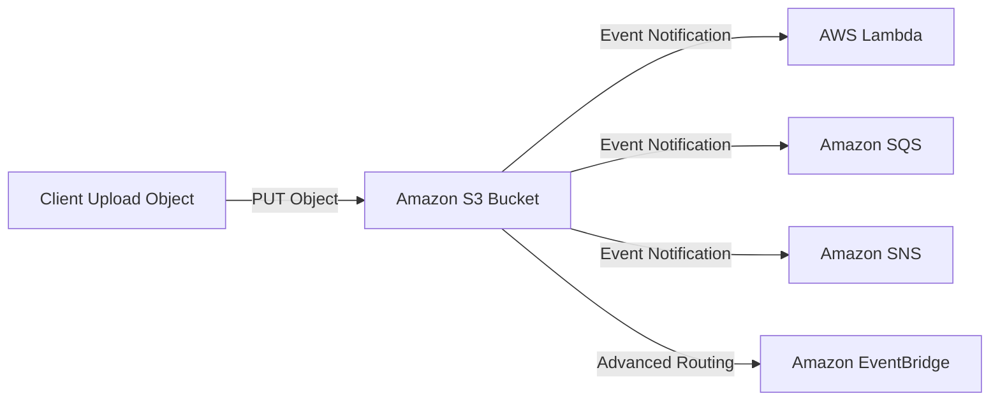
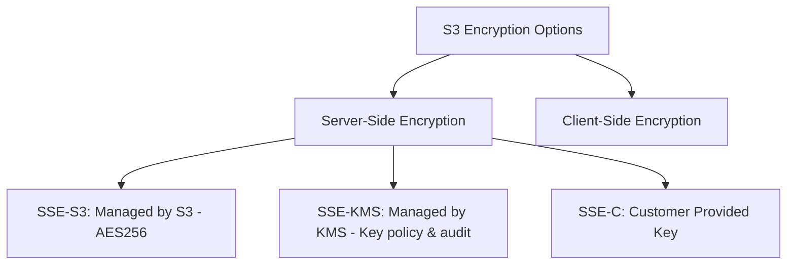

# 🪣 Amazon S3 (Simple Storage Service) — AWS DVA-C02 Notes

> **Domain:** Development with AWS Services (32%) & Security (26%)  
> **Trọng tâm thi DVA-C02:** Presigned URLs, Multipart Upload, Performance Optimization, Lifecycle Rules, CORS, S3 Event Notifications, Security & Encryption.

---

## 📦 1. Storage Classes (Các lớp lưu trữ S3)

| Storage Class | Nhóm Use Case | Availability | Min Duration | Cost Trait |
| :--- | :--- | :--- | :--- | :--- |
| **S3 Standard** | Dữ liệu truy cập thường xuyên, millisecond access. | 99.99% | N/A | High storage cost, Free retrieval |
| **S3 Intelligent-Tiering** | Dữ liệu không rõ access pattern hoặc biến động. Tự động chuyển tier (Freq $\leftrightarrow$ Infreq $\leftrightarrow$ Archive) dựa trên nhu cầu. | 99.9% | N/A | Small auto-tiering fee, không tốn phí retrieval |
| **S3 Standard-IA** | Dữ liệu ít truy cập nhưng cần lấy ra ngay lập tức ($<100$ms). | 99.9% | 30 ngày | Lower storage, tính phí Retrieval |
| **S3 One Zone-IA** | Dữ liệu ít truy cập, tái tạo lại được (không cần HA đa AZ). | 99.5% | 30 ngày | 20% rẻ hơn Standard-IA, 1 AZ |
| **S3 Glacier Instant Retrieval** | Archive dữ liệu hiếm khi dùng (vài lần/năm) nhưng cần millisecond access. | 99.9% | 90 ngày | Rất rẻ storage, tính phí Retrieval |
| **S3 Glacier Flexible Retrieval** | Archive dữ liệu. Retrieval time: Expedited (1-5m), Standard (3-5h), Bulk (5-12h). | 99.9% | 90 ngày | Rất rẻ |
| **S3 Glacier Deep Archive** | Lưu trữ lịch sử lâu dài (retention/compliance), Retrieval time: Standard (12h), Bulk (48h). | 99.9% | 180 ngày | Rẻ nhất hệ thống |

---

## ⚡ 2. DVA-C02 Key Developer Features

### 2.1 Presigned URLs (Upload / Download tạm thời)
* **Khái niệm:** Tạo 1 URL có kèm credentials + thời gian hết hạn (expiration time) để cho phép client (User/Browser) upload hoặc download object trực tiếp từ S3 mà **không cần mở public bucket** và **không cần cấp IAM credentials** cho client.
* **Cách tạo:** Tạo thông qua SDK (`s3.getSignedUrl` / `generate_presigned_url`) hoặc CLI với tư cách của IAM Identity đang có quyền trên object đó.
* **Thi lưu ý:** Presigned URL sở hữu **quyền của IAM User/Role tạo ra nó**. Nếu IAM User tạo URL bị mất quyền hoặc bị xóa, URL đó sẽ hết hiệu lực ngay lập tức.

---

### 2.2 Multipart Upload (Upload file dung lượng lớn)
* **Quy tắc bắt buộc:**
  * File $> 100$ MB: **Khuyến khích** dùng Multipart Upload.
  * File $> 5$ GB: **BẮT BUỘC** dùng Multipart Upload (limit của single PUT request là 5GB).
* **Cơ chế hoạt động:** Chia file thành các part nhỏ ($5$MB - $5$GB/part), upload song song $\rightarrow$ Gọi `CompleteMultipartUpload` để gộp lại.
* **Mẹo tiết kiệm chi phí trong thi:**
  * Nếu Multipart Upload bị dừng dở dang (abort/fail), các part đã upload vẫn tồn tại và **AWS vẫn tính tiền lưu trữ**.
  * **Giải pháp:** Cấu hình **S3 Lifecycle Policy** với action `AbortIncompleteMultipartUpload` sau $N$ ngày.

---

### 2.3 S3 Event Notifications
* Phát sự kiện (Event) khi có hành động `s3:ObjectCreated:*`, `s3:ObjectRemoved:*`, `s3:ObjectRestore:*`...
* **Target tích hợp sẵn:**
  1. **AWS Lambda** (Xử lý async, ví dụ: Resize ảnh khi upload).
  2. **Amazon SQS** (Hàng đợi message).
  3. **Amazon SNS** (Topic thông báo).
  4. **Amazon EventBridge** (Nâng cao: Rule matching, gửi tới nhiều target hơn).



---

### 2.4 Performance & Optimization (S3 Performance)
* **Request rate limit:**
  * $3,500$ **PUT/COPY/POST/DELETE** requests/second trên mỗi **prefix**.
  * $5,500$ **GET/HEAD** requests/second trên mỗi **prefix**.
* **Tối ưu băng thông/tốc độ:**
  1. **Scale ngang với Prefix:** Phân chia thư mục/prefix hợp lý (ví dụ: `/images/`, `/documents/`).
  2. **S3 Transfer Acceleration:** Sử dụng **Amazon CloudFront Edge Locations** để tăng tốc upload/download file lớn trên khoảng cách địa lý xa.
  3. **Byte-Range Fetches:** Dùng Header `Range: bytes=0-1024` để tải song song từng đoạn của file lớn (GET requests).

---

## 🔒 3. S3 Security & Encryption

### 3.1 Encryption Options (Mã hóa dữ liệu)



1. **SSE-S3 (Server-Side Encryption with S3 Managed Keys):**
   * AWS tự quản lý key (AES-256). Mặc định bật cho tất cả bucket mới.
   * Header khi request: `"x-amz-server-side-encryption": "AES256"`.
2. **SSE-KMS (Server-Side Encryption with AWS KMS Keys):**
   * Sử dụng KMS Key. Có tính năng kiểm soát quyền đọc key (KMS Key Policy) & Audit log qua CloudTrail.
   * Header khi request: `"x-amz-server-side-encryption": "aws:kms"`.
   * **Thi lưu ý:** KMS có **Throttling limit** (KMS Request Rate Limit). Nếu số lượng S3 GET/PUT quá lớn dùng SSE-KMS có thể bị nảy lỗi `KMS ThrottlingException`.
3. **SSE-C (Server-Side Encryption with Customer-Provided Keys):**
   * Khách hàng gửi Encryption Key cùng với HTTP Request (bắt buộc qua HTTPS). AWS không lưu key.
4. **Client-Side Encryption:**
   * Client tự encrypt data trước khi gửi lên S3, tự decrypt khi tải về.

---

### 3.2 S3 Security Policies & CORS
* **Bucket Policy:** Resource-based policy bằng JSON, quản lý truy cập cấp Bucket (Public access, Enforce HTTPS via `aws:SecureTransport`, Restrict IP...).
* **CORS (Cross-Origin Resource Sharing):** Bắt buộc cấu hình CORS ở S3 nếu một trang web ở Origin A (ví dụ: `https://myapp.com`) gọi AJAX/Fetch để tải tài nguyên trực tiếp từ S3 Bucket Origin B (ví dụ: `https://mybucket.s3.amazonaws.com`).

---

## 🎯 4. Mẹo thi DVA-C02 (Exam Tips & Pitfalls)

1. **Bắt buộc HTTPS:** Muốn từ chối mọi connection không dùng SSL/TLS, thêm Condition vào Bucket Policy:
   ```json
   "Condition": {
     "Bool": { "aws:SecureTransport": "false" }
   }
   ```
2. **Static Website Hosting vs Presigned URL:**
   * Static Website URL có dạng: `http://<bucket-name>.s3-website.<region>.amazonaws.com`. Không hỗ trợ HTTPS trực tiếp (cần kết hợp CloudFront nếu muốn HTTPS).
3. **Versioning:**
   * Sau khi bật Versioning, không thể "Tắt" (Disable) mà chỉ có thể "Suspend".
   * Khi `DELETE` an object mà không chỉ định Version ID $\rightarrow$ S3 tạo 1 **Delete Marker**. Muốn xóa hẳn phải chỉ định Version ID.
4. **Consistency Model:** S3 hiện tại hỗ trợ **Strong Read-After-Write Consistency** cho tất cả PUT và DELETE requests.

---

## 📋 Checklist tự kiểm tra kiến thức S3

- [x] Nắm rõ các Storage Classes & khi nào dùng loại nào
- [x] Hiểu cách tạo & ứng dụng Presigned URL
- [x] Biết giới hạn 5GB của single PUT & cách dùng Multipart Upload
- [x] Cấu hình S3 Event Notifications với Lambda/SQS/SNS
- [x] Phân biệt SSE-S3, SSE-KMS, SSE-C
- [x] Hiểu cách dùng CORS khi fetch data từ frontend
- [x] Tối ưu Performance: Byte-Range Fetch, Transfer Acceleration, AbortIncompleteMultipartUpload
