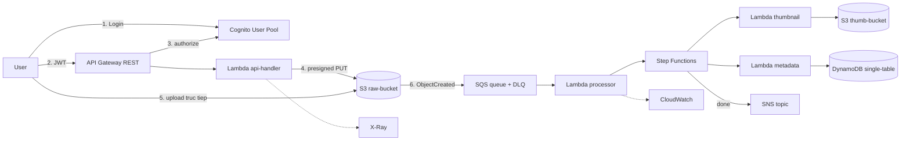

# 📸 LAB PROJECT — "SnapVault" (Serverless File Sharing API)

> **Mục tiêu:** Một project xuyên suốt thay cho 10 lab rời rạc, phủ ~95% blueprint DVA-C02.
> **Stack:** Node.js 22 + TypeScript · AWS SAM · ap-southeast-1
> **Chi phí mục tiêu:** ~$0 (Free Tier) — có Budget alert + teardown sau mỗi phase.

---

## 🏗️ Kiến trúc tổng thể (đích đến sau 10 phase)

**Luồng chính:** User login → xin presigned URL → upload thẳng lên S3 (không đi qua Lambda) → S3 event → SQS (có DLQ) → Lambda → Step Functions xử lý ảnh → ghi DynamoDB → SNS thông báo.

---

## 💰 QUY TẮC CHI PHÍ (account cá nhân — thoải mái nghịch, chỉ canh tiền)

| Quy tắc | Chi tiết |
| :--- | :--- |
| **Budget alert** | Bắt buộc ở Phase 0: AWS Budgets $5/tháng + email alert ở 50% / 80% / 100%. |
| **Region cố định** | Chỉ làm ở `ap-southeast-1`. Resource lạc region khác rất dễ bị quên → âm thầm tính tiền. |
| **Prefix** | Resource tên `dva-*`, stack `dva-snapvault` — để dễ rà soát và xóa sạch. |
| **Tag** | `Project=dva-lab` trong `samconfig.toml` → lọc được trong Cost Explorer. |
| **Thứ tốn tiền thật** | ❌ NAT Gateway (~$32/tháng) · ❌ RDS · ❌ EC2 chạy 24/7 · ⚠️ Provisioned Concurrency để qua đêm · ⚠️ DynamoDB provisioned capacity cao · ⚠️ CloudWatch Logs giữ vĩnh viễn (set `RetentionInDays: 7`). |
| **Teardown** | Cuối mỗi buổi: empty S3 bucket → `sam delete --stack-name dva-snapvault`. |
| **Rà định kỳ** | Cuối mỗi phase: Billing Console → Cost Explorer, xem có gì phát sinh bất thường không. |

> [!TIP]
> Toàn bộ 10 phase gần như nằm trong Free Tier: Lambda 1M request/tháng, API Gateway 1M call (12 tháng đầu), DynamoDB 25GB + 25 WCU/RCU, SQS 1M request, SNS 1M publish, Step Functions 4,000 transition, X-Ray 100,000 trace. Phần dễ vượt nhất là **S3 storage** và **CloudWatch Logs** — nên luôn teardown.

---

## 📅 Lộ trình 10 Phase

### Phase 0 — Setup & An toàn
**Làm gì:**
- Cài SAM CLI
- Config AWS CLI **profile riêng tên `dva`** (không dùng `default`, tránh lỡ tay deploy vào môi trường công việc)
- Tạo AWS Budget $5 + email alert — ⚠️ sửa `YOUR_EMAIL@example.com` trong `phase-00-setup/budget-notifications.json` thành email thật trước khi chạy (placeholder để không commit email lên repo public)
- `aws sts get-caller-identity --profile dva` xác nhận identity

**Kiến thức thi:** Shared Responsibility Model · IAM credentials & CLI profile · STS `GetCallerIdentity`
**Output:** `00-setup.md` ghi lại lệnh + kết quả

---

### Phase 1 — Lambda + API Gateway (nền móng)
**Làm gì:**
- `sam init` → TypeScript template
- 1 Lambda `api-handler` + REST API: `GET /health`, `POST /files`
- `sam local invoke` / `sam local start-api` test offline, rồi `sam deploy --guided`
- Nghịch: đổi memory 128 → 1024 MB, đo lại latency (cold start)

**Kiến thức thi:**
- Execution role vs resource-based policy (xem `AWS::Lambda::Permission` mà SAM tự sinh ra)
- Sync vs Async invocation
- Cold start · memory ↔ CPU tradeoff · timeout
- API Gateway: resource/method/integration · stage · CORS · **Lambda proxy vs non-proxy integration**
- SAM template anatomy: `Transform`, `Globals`, `AWS::Serverless::Function`, `Events`

**Checkpoint:** *Proxy integration khác non-proxy ở chỗ nào? Tại sao response bắt buộc có `statusCode` và `body` dạng string?*

---

### Phase 2 — DynamoDB (data layer)
**Làm gì:**
- Single-table design: `PK=USER#<id>`, `SK=FILE#<fileId>`
- GSI1 query theo trạng thái xử lý: `GSI1PK=STATUS#pending`
- CRUD đầy đủ qua API: create / list (Query) / get / delete
- TTL cho item tạm · conditional write chống ghi đè (optimistic locking bằng field `version`)
- Đo thực tế: `Query` vs `Scan` trên 1000 item — so sánh RCU consumed

**Kiến thức thi:**
- Partition key vs Sort key · thiết kế theo access pattern
- **GSI vs LSI** (cặp dễ nhầm): LSI phải tạo cùng lúc tạo table, dùng chung partition key, hỗ trợ strongly consistent read · GSI tạo lúc nào cũng được, chỉ eventually consistent
- On-Demand vs Provisioned capacity
- Conditional write + `ConditionalCheckFailedException`
- BatchGetItem / BatchWriteItem · TransactWriteItems
- TTL · Query vs Scan cost

**Checkpoint:** *`ProjectionExpression` có làm giảm RCU không?* (bẫy thi kinh điển)

---

### Phase 3 — S3 (presigned URL + event)
**Làm gì:**
- Lambda sinh presigned PUT URL hết hạn 5 phút → upload bằng `curl` không cần credentials
- Bật versioning · lifecycle: 30 ngày → IA, 90 ngày → Glacier
- S3 event `ObjectCreated:*` → Lambda (tạm thời gọi trực tiếp; Phase 4 sẽ chèn SQS vào giữa)
- Thử multipart upload file lớn bằng CLI

**Kiến thức thi:** Presigned URL · Storage classes · Lifecycle policy · Event notification · Multipart upload · CRR · Static website hosting
**Ôn lại:** [02-S3/README.md](../02-S3/README.md)

**Checkpoint:** *Presigned URL mang quyền của ai — người tạo URL hay người dùng URL? Điều gì xảy ra nếu role tạo URL bị thu hồi quyền sau đó?*

---

### Phase 4 — Messaging: SQS · SNS · EventBridge · Step Functions
**Làm gì:**
- Chèn SQS vào giữa: S3 → SQS → Lambda, kèm DLQ `maxReceiveCount=3`
- Cố tình throw error trong Lambda → xem message rơi vào DLQ, thực hành redrive
- Set visibility timeout **nhỏ hơn** Lambda timeout → quan sát duplicate processing
- SNS fan-out: 1 topic → 2 SQS queue
- EventBridge rule chạy cleanup Lambda mỗi 5 phút (scheduled)
- Step Functions: `resize → extract metadata → notify`, có `Retry` + `Catch`

**Kiến thức thi:**
- **SQS vs SNS vs EventBridge** (cặp dễ nhầm #1)
- Standard vs FIFO queue · visibility timeout · long polling
- DLQ & redrive policy
- Event source mapping (batch size, batching window, partial batch failure)
- Step Functions Standard vs Express · Retry/Catch

**Checkpoint:** *Visibility timeout nên đặt bao nhiêu so với Lambda timeout, và tại sao AWS khuyến nghị ≥ 6x?*

---

### Phase 5 — Cognito (authentication)
**Làm gì:**
- Tạo User Pool + App Client → signup/login bằng CLI lấy JWT
- Gắn Cognito Authorizer vào API Gateway → gọi API không token = 401
- Decode ID token vs Access token, so sánh claims
- Tạo Identity Pool → đổi JWT lấy temp AWS credentials → upload S3 trực tiếp bằng SDK

**Kiến thức thi:**
- **User Pool vs Identity Pool** (cặp dễ nhầm #2): User Pool = authentication (bạn là ai) · Identity Pool = authorization (đổi lấy IAM credentials để gọi AWS service)
- JWT flow: ID token / Access token / Refresh token
- Authorizer types: IAM · Lambda authorizer · Cognito
- `AssumeRoleWithWebIdentity`
- Federated identity (Google/SAML — đọc lý thuyết)

---

### Phase 6 — KMS & Secrets
**Làm gì:**
- Tạo CMK → bật SSE-KMS cho S3 bucket và DynamoDB table
- Lambda gọi `GenerateDataKey` → **envelope encryption** 1 field nhạy cảm trước khi lưu DynamoDB
- Thêm encryption context, thử decrypt với context sai → đọc lỗi
- Lưu "API key bên thứ 3" vào Parameter Store (SecureString) **và** Secrets Manager → so sánh
- Sửa KMS key policy để chặn Lambda role → đọc `AccessDeniedException`

**Kiến thức thi:**
- CMK vs Data key · **Envelope encryption** · Encryption context
- KMS key policy vs IAM policy (KMS yêu cầu **cả hai**)
- **Secrets Manager vs Parameter Store** (cặp dễ nhầm #3): rotation tự động, chi phí, giới hạn kích thước
- Encryption at rest vs in transit
- Lambda environment variable encryption

---

### Phase 7 — CloudFormation/SAM nâng cao + Deployment strategies
**Làm gì:**
- Refactor template: `Parameters`, `Mappings`, `Outputs`, `Conditions`, intrinsic functions (`!Ref`, `!GetAtt`, `!Sub`, `!Join`)
- Tách nested stack (storage stack / api stack)
- Tạo **Change Set** trước khi deploy → đọc xem resource nào bị `Replacement: True`
- Lambda alias `live` + `AutoPublishAlias` + `DeploymentPreference: Canary10Percent5Minutes` (CodeDeploy)
- Deploy bản lỗi có chủ đích → CloudWatch alarm kích hoạt → quan sát **auto rollback**
- `DeletionPolicy: Retain` cho S3 bucket

**Kiến thức thi:**
- Template structure · intrinsic functions
- Stack update behavior: No interruption / Some interruption / **Replacement**
- Change sets · nested stacks · stack policy · DeletionPolicy
- **Lambda traffic shifting:** All-at-once / Linear / Canary
- In-place vs Rolling vs Blue/Green vs Canary (cặp dễ nhầm)
- `sam build` / `sam deploy` / `sam local` / `sam logs`

---

### Phase 8 — CI/CD Pipeline
**Làm gì:**
- Đẩy repo lên CodeCommit (hoặc GitHub + CodeStar connection)
- `buildspec.yml`: install → pre_build (test) → build (`sam build`) → post_build (`sam package`)
- CodePipeline: Source → Build → Deploy-dev → Manual approval → Deploy-prod
- Làm fail test có chủ đích → xem pipeline dừng ở stage nào, artifact nằm đâu

**Kiến thức thi:** buildspec.yml phases & artifacts · CodePipeline stage/action/artifact store (S3) · CodeDeploy `appspec.yml` · Manual approval · Rollback

> [!NOTE]
> CodeCommit không còn mở cho account AWS tạo sau 2024-07 → nhiều khả năng account bạn không có. Dùng GitHub + CodeConnections thay thế. Đề thi vẫn hỏi CodeCommit nên phần lý thuyết vẫn phải đọc.

---

### Phase 9 — Observability
**Làm gì:**
- Bật X-Ray (`Tracing: Active`) cho Lambda + API Gateway → xem service map
- Thêm custom subsegment bao quanh call DynamoDB
- Custom metric bằng **EMF** (log JSON đúng format → CloudWatch tự tạo metric, không cần `PutMetricData`)
- CloudWatch Alarm: Lambda Errors > 5 trong 5 phút → SNS email
- Logs Insights: query tìm request chậm nhất, đếm lỗi theo loại
- Vào CloudTrail Event History truy ra ai đã tạo DynamoDB table

**Kiến thức thi:**
- X-Ray segment vs subsegment · service map · sampling rule · daemon
- CloudWatch namespace / dimension / custom metric · EMF
- Logs Insights query syntax
- **CloudTrail vs CloudWatch** (cặp dễ nhầm #4): audit API call vs monitoring metrics/logs

---

### Phase 10 — Troubleshooting Drills (phá rồi sửa)
Phase **quan trọng nhất cho Domain 4 (18%)** — đề thi toàn câu tình huống "app bị X, nguyên nhân là gì".

| # | Cách phá | Phải tự chẩn đoán được |
| :--- | :--- | :--- |
| 1 | DynamoDB provisioned 1 RCU/1 WCU rồi bắn 100 request | `ProvisionedThroughputExceededException` → on-demand / exponential backoff |
| 2 | Hot partition (mọi item cùng 1 PK) | Throttling dù capacity tổng còn dư → redesign partition key |
| 3 | Xóa 1 action trong Lambda execution role | `AccessDeniedException` → dùng CloudTrail tìm action còn thiếu |
| 4 | Lambda timeout 3s gọi API chậm 10s | `Task timed out` → tăng timeout hoặc chuyển async |
| 5 | API Gateway integration chậm | 504 — giới hạn cứng 29s của API Gateway |
| 6 | S3 gọi Lambda nhưng thiếu resource-based policy | 403 — phân biệt execution role vs resource policy |
| 7 | CORS sai | Browser lỗi nhưng `curl` vẫn chạy → preflight OPTIONS |
| 8 | Reserved concurrency = 0 | Throttle 100% → reserved vs provisioned concurrency |

---

## 📌 Phần KHÔNG build (học lý thuyết riêng)
Tốn tiền hoặc không đáng build cho mục tiêu thi — sẽ viết note lý thuyết riêng trong repo:
- Elastic Beanstalk (deployment policies, `.ebextensions`, worker tier)
- ElastiCache (Redis vs Memcached · lazy loading vs write-through)
- Kinesis Data Streams · CloudHSM · Lambda@Edge · DAX

---

## ✅ Tiến độ

- [ ] Phase 0 — Setup & An toàn
- [ ] Phase 1 — Lambda + API Gateway
- [ ] Phase 2 — DynamoDB
- [ ] Phase 3 — S3 presigned + event
- [ ] Phase 4 — SQS / SNS / EventBridge / Step Functions
- [ ] Phase 5 — Cognito
- [ ] Phase 6 — KMS & Secrets
- [ ] Phase 7 — CFN/SAM nâng cao + Canary deploy
- [ ] Phase 8 — CI/CD Pipeline
- [ ] Phase 9 — Observability
- [ ] Phase 10 — Troubleshooting Drills

**Cách làm mỗi phase:** build trước → giải thích "tại sao AWS thiết kế như vậy" → chốt lại bằng note vào thư mục service tương ứng (`03-Lambda/`, `04-DynamoDB/`…) theo đúng style `01-IAM` → cuối phase làm 5–10 câu hỏi kiểu đề thi.
